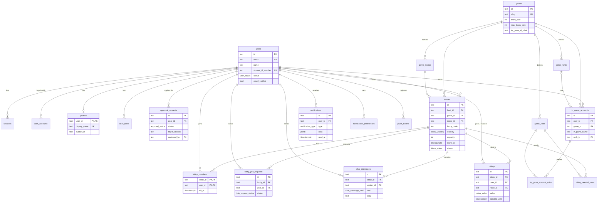

# Database design: MVP-1

**Engine:** PostgreSQL (development on a Neon branch; production on the VPS or Neon Free, see [SPEC 5.1](../../SPEC.md#51-hosting-options))
**Schema source of truth:** [`apps/api/prisma/schema.prisma`](../../apps/api/prisma/schema.prisma)
**Migrations:** [`apps/api/prisma/migrations/`](../../apps/api/prisma/migrations)
**Status:** Increment 1 (MVP-1): 23 tables, applied to the Neon `dev` branch (PostgreSQL 18) on 2026-10-24. Knowledge sharing, moderation and tournaments come in later increments.

## Contents

1. [Scope](#1-scope)
2. [Entity-relationship diagram](#2-entity-relationship-diagram)
3. [Tables](#3-tables)
4. [Enums](#4-enums)
5. [Constraints and indexes](#5-constraints-and-indexes)
6. [Conventions](#6-conventions)
7. [Changes from the original ERD](#7-changes-from-the-original-erd)
8. [Seed data](#8-seed-data)
9. [Working with the database](#9-working-with-the-database)

---

## 1. Scope

MVP-1 delivers these features, and the schema covers exactly what they need:

| Feature | Tables |
|---|---|
| a. Authentication (email code + student ID number + admin approval; no ID photo yet) | `users`, `sessions`, `auth_accounts`, `verifications`, `user_roles`, `approval_requests` |
| b. Profile editing | `profiles`, `in_game_accounts`, `in_game_account_roles` |
| c. Lobby CRUD | `lobbies`, `lobby_needed_roles`, `lobby_members`, `lobby_join_requests`, `chat_messages` |
| d. Real-time notifications | `notifications`, `notification_preferences`, `push_tokens` |
| e. Post-match feedback | `ratings` |
| Shared reference data | `games`, `game_ranks`, `game_roles`, `game_modes`, `settings` |

## 2. Entity-relationship diagram

Columns are abbreviated to keys and the most important fields. The full definitions are in `schema.prisma`.



The full ERD for all phases (including knowledge, moderation and tournaments) is in [`diagrams/3-erd.drawio`](../../diagrams/3-erd.drawio).

## 3. Tables

### Accounts and authentication

| Table | Purpose | Key points |
|---|---|---|
| `users` | One row per person. | `status`: pending → approved / rejected; suspended or banned later. `student_id_number` is unique, never shown publicly (PRO-04), and empty until sign-up step 3. `deleted_at` supports account deletion (ACC-10). |
| `sessions` | Login sessions (Better Auth). | `token` is unique. Deleted when a user is banned so they're logged out everywhere (ACC-09). |
| `auth_accounts` | Login methods (Better Auth "account"). | Email + password uses `provider_id = 'credential'` with the password hash in `password`. |
| `verifications` | Email codes and password-reset tokens (Better Auth). | Short-lived; `expires_at` is checked on use. |
| `user_roles` | Which roles a user has. | Composite key (`user_id`, `role`), so a user can be e.g. both moderator and organizer. Every approved user gets `player`. |
| `approval_requests` | Admin review of each sign-up (ACC-03/04). | A re-application creates a new row, keeping the history. `id_photo_key` stays empty until the photo-upload increment. |

### Profiles

| Table | Purpose | Key points |
|---|---|---|
| `profiles` | Public gamer profile, 1:1 with `users`. | `display_name` (gamer tag) is unique. |
| `in_game_accounts` | A player's ID and rank for one game. | Unique per (`user_id`, `game_id`). Rank is self-reported (PRO-03). |
| `in_game_account_roles` | Preferred roles for that game (e.g. Tank + Support). | Join table to `game_roles`. |

### Games catalogue

| Table | Purpose | Key points |
|---|---|---|
| `games` | Supported games, managed by admins (GAM-01). | `team_size`, `max_lobby_size` and `in_game_id_label` (e.g. "Riot ID (name#tag)") drive the app's forms. Hidden games keep `is_active = false`. |
| `game_ranks` | Rank ladder per game. | `tier_order` 1 = lowest; used for rank-range filters. |
| `game_roles` | Player roles per game. | |
| `game_modes` | Game modes per game. | |

### Lobbies

| Table | Purpose | Key points |
|---|---|---|
| `lobbies` | A recruitment listing. | `lobby_code` is required (LOB-02) and must never be returned to non-members of a private lobby (NFR-06): enforced in the API. `capacity` counts the host. `status`: open → full → in_progress → closed / expired. |
| `lobby_needed_roles` | Roles the host is looking for. | |
| `lobby_members` | Who is in a lobby, including the host. | `left_at` is set on leave and cleared on rejoin. Members with `left_at IS NULL` at close time can rate each other. |
| `lobby_join_requests` | Requests to join a private lobby (LOB-05). | One row per (lobby, player); asking again after a decline updates the row. |
| `chat_messages` | Lobby chat (LOB-11). | `kind = system` rows (joins, leaves, code changes) have no `sender_id`. Deleted 7 days after the lobby closes by a scheduled job. |

### Feedback and notifications

| Table | Purpose | Key points |
|---|---|---|
| `ratings` | Post-match 👍 / no-show ratings (REP-01). | One rating per (lobby, rater, ratee); can be changed until `editable_until` (24 h, REP-03). Reputation is calculated from this table. |
| `notifications` | In-app inbox (NOT-01/04). | `data` holds IDs for deep links (e.g. `{"lobbyId": "..."}`). Unread = `read_at IS NULL`. |
| `notification_preferences` | Grouped toggles per channel (NOT-03). | No row = defaults (push and in-app on, email off). Account notifications are always sent regardless. |
| `push_tokens` | Expo push tokens per device. | `expo_token` is unique; removed when Expo reports it invalid. |
| `settings` | Admin-editable limits (ADM-06). | Key/value JSON; seeded with spec defaults (see section 8). |

## 4. Enums

| Enum | Values |
|---|---|
| `user_status` | pending, approved, rejected, suspended, banned |
| `role_name` | player, moderator, organizer, admin |
| `approval_status` | pending, approved, rejected |
| `device_platform` | ios, android, web |
| `lobby_visibility` | public, private |
| `lobby_status` | open, full, in_progress, closed, expired |
| `join_request_status` | pending, accepted, declined, cancelled |
| `chat_message_kind` | user, system |
| `rating_value` | good, no_show |
| `notification_group` | account, lobbies, lobby_chat, knowledge, news |
| `notification_type` | account_approved, account_rejected, join_request_received, join_request_accepted, join_request_declined, lobby_member_joined, lobby_member_left, lobby_code_changed, lobby_starting_soon, lobby_closed, rate_teammates, chat_message |

Adding an enum value needs a migration. Removing one needs a data migration first.

## 5. Constraints and indexes

**CHECK constraints** (hand-written at the end of the first migration, because Prisma doesn't model them):

| Constraint | Rule |
|---|---|
| `lobbies_lobby_code_not_blank` | Lobby code can't be empty or whitespace (LOB-02) |
| `lobbies_capacity_range` | 2 ≤ capacity ≤ 100 |
| `ratings_not_self` | A player can't rate themselves |
| `games_sizes_positive` | team_size > 0 and max_lobby_size ≥ team_size |
| `game_ranks_tier_positive` | tier_order > 0 |
| `profiles_display_name_not_blank` | Display name can't be blank |

Rules that depend on other rows or settings (e.g. "at most 3 active lobbies per host", "capacity ≤ the game's max lobby size", "only members can rate") are enforced in the API, inside transactions.

**Indexes** beyond primary keys and unique constraints:

| Index | Supports |
|---|---|
| `lobbies (status, game_id, starts_at)` | Browse & filter open lobbies (LOB-06) |
| `lobbies (host_id, status)` | Active-lobby limit per host (LOB-13) |
| `lobby_members (user_id, left_at)` | "My upcoming lobbies" on Home |
| `lobby_join_requests (lobby_id, status)` | Host's pending requests |
| `chat_messages (lobby_id, created_at)` | Loading chat history in order |
| `ratings (ratee_id)` | Reputation on profiles |
| `notifications (user_id, created_at DESC)`, `(user_id, read_at)` | Inbox and unread count |
| `approval_requests (status, created_at)` | Approval queue, oldest first |
| `users (status)` | Admin filters |

**Delete behaviour:** deleting a user cascades to their sessions, profile, memberships, ratings and notifications. Reviewer and "granted by" links are set to NULL instead. In practice accounts are soft-deleted (`deleted_at`) and personal fields are cleared, so posts can show "Deleted user" (ACC-10). Games can't be deleted while lobbies or in-game accounts use them (`RESTRICT`); hide them with `is_active = false`.

## 6. Conventions

- **Names:** PascalCase models and camelCase fields in TypeScript; snake_case table and column names in PostgreSQL (via `@@map` / `@map`). Tables are plural.
- **IDs:** `text` primary keys holding UUID strings (`@default(uuid())`). See [ADR 0002](../decisions/0002-database-conventions.md).
- **Time:** `timestamp(3)` columns store UTC; the apps convert to local time for display.
- **Every table** that changes has `created_at` and, where edited, `updated_at` (set automatically by Prisma).
- **Enums** use lowercase snake_case values.
- **Secrets** (connection strings) live only in `apps/api/.env`, which Git ignores. `.env.example` shows the format.

## 7. Changes from the original ERD

The draw.io ERD was drawn before development. MVP-1 differs as follows (the ERD will be updated when the full schema is built):

| Change | Reason |
|---|---|
| IDs are `text` instead of `uuid` | Better Auth generates its own string IDs; using text everywhere keeps foreign keys to `users` consistent. |
| `in_game_accounts.preferred_role_id` → join table `in_game_account_roles` | The wireframes let players pick several roles per game. |
| `games.lobby_size` → `max_lobby_size`, plus `slug`, `in_game_id_label`, `sort_order` | Clearer meaning; the label drives the sign-up and profile forms. |
| `lobbies.total_slots` → `capacity` | Capacity counts the host, which avoids off-by-one confusion. |
| `chat_messages.kind` added, `sender_id` nullable | System messages for joins, leaves and code changes (from the wireframes). |
| `ratings.locked_at` → `editable_until` | States the rule directly (REP-03). |
| `notifications.type` is an enum; `link` → `data` (JSON) | Type safety; deep links need IDs rather than URLs in a mobile app. |
| `notification_preferences.type` → `group` | Matches the grouped toggles chosen in the wireframes, with a separate `lobby_chat` group. |
| `user_roles` adds no `player` row automatically | The API adds `player` on approval, so pending users have no role at all. |

## 8. Seed data

`npm run db:seed` loads reference data, and is safe to run repeatedly:

- **Games:** Valorant, Mobile Legends, PUBG Mobile, EA FC and League of Legends, each with ranks, roles and modes.
- **Settings** (defaults come from `SETTING_DEFAULTS` in `@chill-hub/shared`; only created if missing, so admin changes are kept; the old key `max_active_lobbies_per_host` is removed):

| Key | Default | Spec |
|---|---|---|
| `allowed_email_domains` | `["yourcollege.edu"]` (replace with the real domain) | ACC-02 |
| `lobby_expiry_hours` | 2 | LOB-09 |
| `max_active_lobbies_per_player` | 3 | LOB-13 (counts lobbies a player is in, hosting included) |
| `lobby_chat_retention_days` | 7 | LOB-11 |
| `lobby_start_reminder_minutes` | 10 | LOB-12 |
| `rating_edit_window_hours` | 24 | REP-03 |
| `no_show_flag_threshold_percent` | 20 | REP-04 |
| `id_photo_retention_days` | 30 | ACC-08 |

`npm run db:seed:demo` (run after `db:seed`, dev only, refuses `NODE_ENV=production`) adds an admin, three players and two Valorant lobbies (one public, one private) with fixed ids, so it prints the `x-dev-user-id` values to use. The demo users have no passwords; sign-in demo accounts come with the authentication increment, because passwords must be hashed by Better Auth.

## 9. Working with the database

**First-time setup** (Neon dev branch):

1. In the Neon console, create a project (region: Asia Pacific, Singapore), then create a branch called `dev`. The default database `neondb` is fine.
2. Copy `apps/api/.env.example` to `apps/api/.env` and paste the `dev` branch's **pooled** connection string into `DATABASE_URL` and the **direct** one into `DIRECT_URL`. Use `sslmode=verify-full` at the end of both URLs: it also checks Neon's certificate, and `sslmode=require` will behave differently in the next major version of the `pg` driver (it prints a warning).
3. From the repo root:

```bash
npm install
npm run db:migrate
npm run db:seed
```

**Changing the schema:**

1. Edit `apps/api/prisma/schema.prisma`.
2. Run `npm run db:migrate` and give the migration a short name (e.g. `add_reports`). Prisma writes a new folder under `prisma/migrations/`.
3. Review the generated SQL, update this document, and commit the schema and migration together.

**Rules:**

- Never edit a migration that has already been applied to a shared database; add a new one instead.
- Production uses `npm run db:deploy -w @chill-hub/api` (applies pending migrations only, never resets data).
- Browse data locally with `npm run db:studio`.
